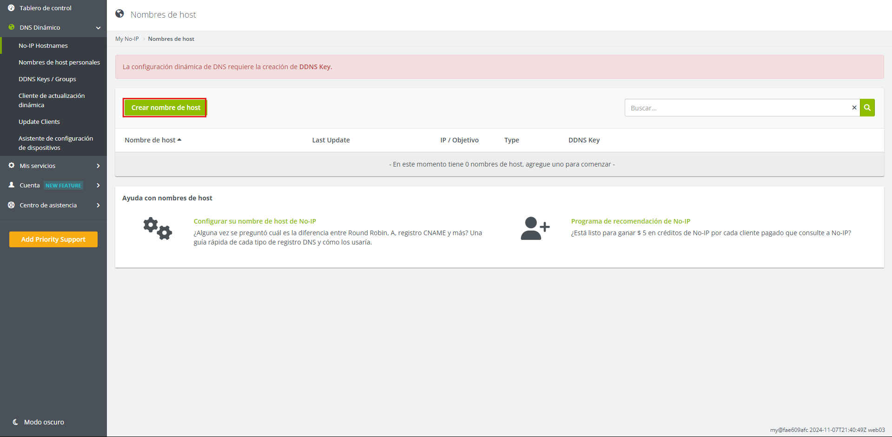
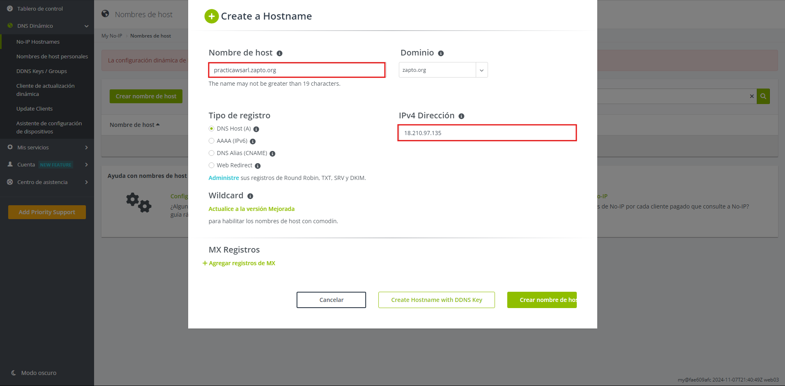

# Practica-IAW-1.9- Arquitectura de una aplicación web LAMP en dos niveles

## Pasos previos a la instalación

**para la instalación vamos a tener que crear la siguiente estructura de directorios y archivos:**


**Una vez creados los archivos y directorios, procedemos a la instalación de las herramientas.**

## Arquitectura de una aplicación web LAMP en dos niveles

## 1. Creamos un nombre de dominio para nuestro servidor con la web `no-ip`

### Paso 1. Crear el nombre del dominio 

Para crear el nombre de dominio en la página, tenemos que registrarnos y dirigirnos al sitio que muestra la captura y darle a **crear nombre de host**.



Una vez dado al recuadro de crear el nombre, nos sale un asistente para poner el nombre de host que queramos, el dominio que queremos que lleve, la dirección ip de la máquina o pc que queremos que tenga ese nombre de host y el tipo de registro que queremos que lleve, en nuestro caso es el **DNS Host A**



Hecho esto ya podemos automatizar el proceso de la arquitectura de una aplicación web LAMP en dos niveles

## 2. Creación del archivo `install_lamp_frontend` para la máquina frontend

### Paso 1. Importamos el archivo de variables y mostramos los comandos que se van ejecutando 

```bash
source .env
```

```bash
set -ex
```

### Paso 2. Eliminamos descargas previas del codigo fuente de WordPress

```bash
rm -rf /tmp/latest.tar.gz
```

> [!TIP]  
> Hacemos esto para evitar que haya duplicados dentro de ese directorio a la hora de descargarnos el codigo fuente de WordPress.

### Paso 3. Descargamos el codigo fuente de WordPress

```bash
wget https://wordpress.org/latest.tar.gz -P /tmp
```

### Paso 4. Descomprimimos el codigo fuente de WordPress

```bash
tar -xzvf /tmp/latest.tar.gz -C /tmp
```

> [!NOTE]  
> Utilizamos los siguientes parámetros:
> 
> * `-x`: Indica que deseamos extraer el contenido del archivo.
>
> * `-z`: Señala que queremos descomprimir el archivo.
>
> * `-v`: Activa el modo detallado para mostrar en pantalla el proceso de descompresión.
>
> * `-f`: Se usa para especificar el nombre del archivo de entrada.
>
> * `-C`: Se utiliza para definir el directorio de destino.


### Paso 5. Eliminamos el contenido de instalaciones previas en /var/www/html

```bash
rm -rf /var/www/html/*
```

### Paso 6. Movemos el código fuente de WordPress a /var/www/html

```bash
mv -f /tmp/wordpress/* /var/www/html
```

### Paso 7. Creamos la base de datos y el usuario para WordPress

```bash
mysql -u root <<< "DROP DATABASE IF EXISTS $WORDPRESS_DB_NAME"
mysql -u root <<< "CREATE DATABASE $WORDPRESS_DB_NAME"
mysql -u root <<< "DROP USER IF EXISTS $WORDPRESS_DB_USER@$IP_CLIENTE_MYSQL"
mysql -u root <<< "CREATE USER $WORDPRESS_DB_USER@$IP_CLIENTE_MYSQL IDENTIFIED BY '$WORDPRESS_DB_PASSWORD'"
mysql -u root <<< "GRANT ALL PRIVILEGES ON $WORDPRESS_DB_NAME.* TO $WORDPRESS_DB_USER@$IP_CLIENTE_MYSQL"
```

> [!IMPORTANT]  
> Las variables las cambiamos por las que tenemos en el archivo `.env` configuradas para que se cree todo correctamente.

### Paso 8. Creamos el archivo de configuracion de WordPress

```bash
cp /var/www/html/wp-config-sample.php /var/www/html/wp-config.php
```

### Paso 9. Configuramos el archivo de configuracion de WordPress

```bash
sed -i "s/database_name_here/$WORDPRESS_DB_NAME/" /var/www/html/wp-config.php
sed -i "s/username_here/$WORDPRESS_DB_USER/" /var/www/html/wp-config.php
sed -i "s/password_here/$WORDPRESS_DB_PASSWORD/" /var/www/html/wp-config.php
sed -i "s/localhost/$WORDPRESS_DB_HOST/" /var/www/html/wp-config.php
```

> [!IMPORTANT]  
> Este archivo lo modificamos ya que el original tiene unas variables que no tenemos y que si dejamos el archivo tal cual como viene pues no funcionaría. Así que, con el comando `sed -i` lo cambiamos con nuestras variables que tenemos en el archivo `.env`.

### Paso 10. Cambiamos el propietario y el grupo al directorio /var/www/html/

```bash
chown -R www-data:www-data /var/www/html/
```

### Paso 11. Comprobación de que funciona WordPress


----
## 3. Creación del archivo `deploy_wordpress_own_directory` para la instalación en la raíz

### Paso 1. Importamos el archivo de variables y mostramos los comandos que se van ejecutando 

```bash
source .env
```

```bash
set -ex
```

### Paso 2. Eliminamos descargas previas del codigo fuente de WordPress

```bash
rm -rf /tmp/latest.tar.gz
```

### Paso 3. Descargamos el codigo fuente de WordPress

```bash
wget https://wordpress.org/latest.tar.gz -P /tmp
```

### Paso 4. Descomprimimos el codigo fuente de WordPress

```bash
tar -xzvf /tmp/latest.tar.gz -C /tmp
```

### Paso 5. Eliminamos el contenido de instalaciones previas en /var/www/html

```bash
rm -rf /var/www/html/*
```

### Paso 6. Creamos el directorio para la instalación de WordPress

```bash
mkdir -p /var/www/html/$WORDPRESS_DIRECTORY
```

> [!IMPORTANT]  
> Las variables que irán apareciendo durante los pasos están todas definidas en el archivo `.env` y en `.env.example` se pueden ver las variables que hay que tener definidas.

### Paso 7. Movemos el código fuente de WordPress a /var/www/html

```bash
mv -f /tmp/wordpress/* /var/www/html/$WORDPRESS_DIRECTORY
```

### Paso 8. # Creamos la base de datos y el usuario para WordPress

```bash
mysql -u root <<< "DROP DATABASE IF EXISTS $WORDPRESS_DB_NAME"
mysql -u root <<< "CREATE DATABASE $WORDPRESS_DB_NAME"
mysql -u root <<< "DROP USER IF EXISTS $WORDPRESS_DB_USER@$IP_CLIENTE_MYSQL"
mysql -u root <<< "CREATE USER $WORDPRESS_DB_USER@$IP_CLIENTE_MYSQL IDENTIFIED BY '$WORDPRESS_DB_PASSWORD'"
mysql -u root <<< "GRANT ALL PRIVILEGES ON $WORDPRESS_DB_NAME.* TO $WORDPRESS_DB_USER@$IP_CLIENTE_MYSQL"
```

### Paso 9. Creamos el archivo de configuracion de WordPress

```bash
cp /var/www/html/$WORDPRESS_DIRECTORY/wp-config-sample.php /var/www/html/$WORDPRESS_DIRECTORY/wp-config.php
```

### Paso 10. Configuramos el archivo de configuracion de WordPress

```bash
sed -i "s/database_name_here/$WORDPRESS_DB_NAME/" /var/www/html $WORDPRESS_DIRECTORY/wp-config.php
sed -i "s/username_here/$WORDPRESS_DB_USER/" /var/www/html/$WORDPRESS_DIRECTORY/wp-config.php
sed -i "s/password_here/$WORDPRESS_DB_PASSWORD/" /var/www/html/$WORDPRESS_DIRECTORY/wp-config.php
sed -i "s/localhost/$WORDPRESS_DB_HOST/" /var/www/html/$WORDPRESS_DIRECTORY/wp-config.php
sed -i "/DB_COLLATE/a define('WP_SITEURL', 'https://$LE_DOMAIN/$WORDPRESS_DIRECTORY');" /var/www/html/wordpress/wp-config.php
sed -i "/WP_SITEURL/a define('WP_HOME', 'https://$LE_DOMAIN');" /var/www/html/wordpress/wp-config.php
```

### Paso 11. Cambiamos el propietario y el grupo al directorio /var/www/html/

```bash
chown -R www-data:www-data /var/www/html/
```

### Paso 12. Copiamos el archivo index.php

```bash
cp /var/www/html/$WORDPRESS_DIRECTORY/index.php /var/www/html
```

### Paso 13. Configuramos el archivo index.php

```bash
sed -i "s#wp-blog-header.php#$WORDPRESS_DIRECTORY/wp-blog-header.php#" /var/www/html/index.php
```

### Paso 14. Borramos los valores por defecto de las security keys que aparecen en el archivo de configuración

```bash
sed -i "/AUTH_KEY/d" /var/www/html/wordpress/wp-config.php
sed -i "/SECURE_AUTH_KEY/d" /var/www/html/wordpress/wp-config.php
sed -i "/LOGGED_IN_KEY/d" /var/www/html/wordpress/wp-config.php
sed -i "/NONCE_KEY/d" /var/www/html/wordpress/wp-config.php
sed -i "/AUTH_SALT/d" /var/www/html/wordpress/wp-config.php
sed -i "/SECURE_AUTH_SALT/d" /var/www/html/wordpress/wp-config.php
sed -i "/LOGGED_IN_SALT/d" /var/www/html/wordpress/wp-config.php
sed -i "/NONCE_SALT/d" /var/www/html/wordpress/wp-config.php
```

> [!IMPORTANT]  
> Eliminamos los valores por defecto de las security keys que aparecen en el archivo de configuración para generar unas nuevas con la API de WordPress.

### Paso 15. Hacemos una llamada a la API de wordpress para obtener las security keys y almacenamos el resultado en una variable de entorno

```bash
SECURITY_KEYS=$(curl https://api.wordpress.org/secret-key/1.1/salt/)
```

### Paso 16. Modificamos las nuevas security keys

```bash
SECURITY_KEYS=$(echo $SECURITY_KEYS | tr / _)
```

> [!IMPORTANT]  
> Las nuevas security keys que acabamos de generar pueden contener el carácter / y este carácter puede darnos problemas a la hora de utilizar el comando sed para añadirlas al archivo de configuración. Para evitar posibles problemas con el carácter / vamos a reemplazarlo por el carácter _..

### Paso 17. Añadimos las security keys al archivo de configuración

```bash
sed -i "/@-/a $SECURITY_KEYS" /var/www/html/wordpress/wp-config.php
```

### Paso 18. Cambiamos el propietario y el grupo al directorio /var/www/html

```bash
chown -R www-data:www-data /var/www/html/
```

### Paso 19. Comprobación de que WordPress funciona


