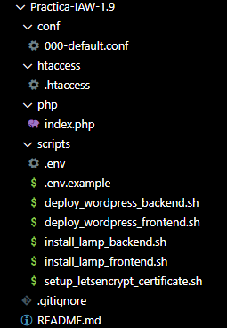
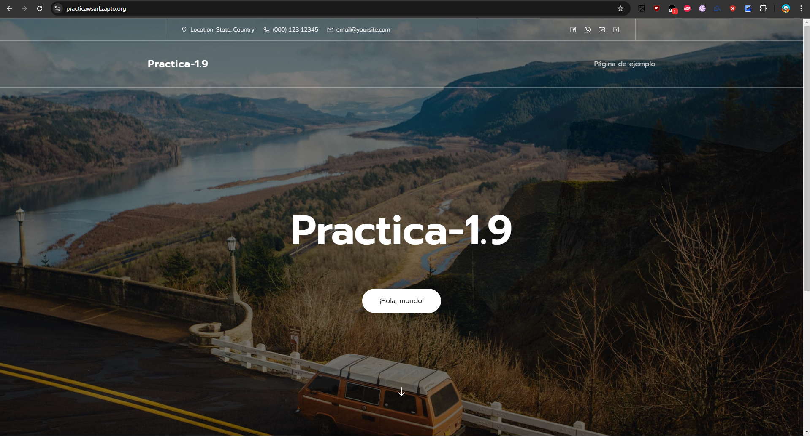
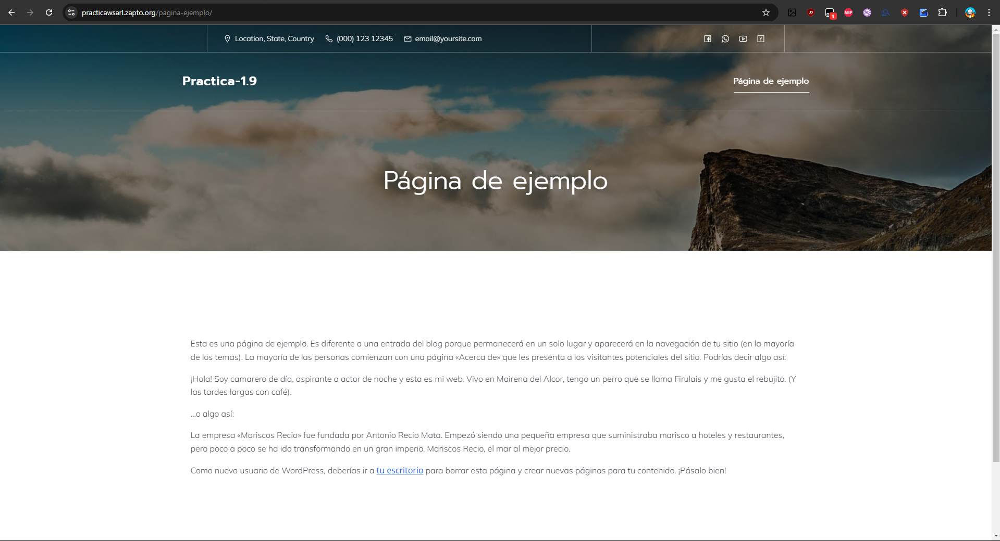
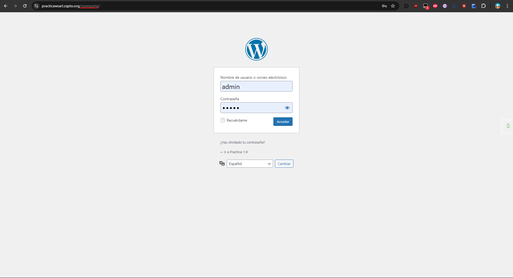
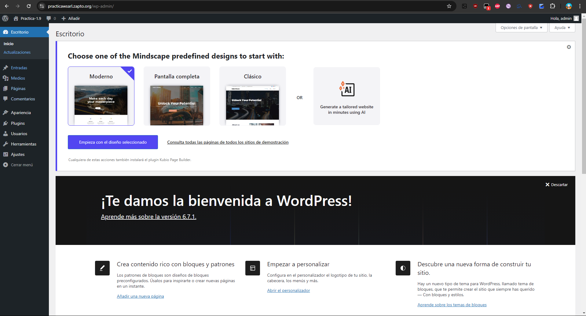

# Practica-IAW-1.9- Arquitectura de una aplicación web LAMP en dos niveles

## Pasos previos a la instalación

**para la instalación vamos a tener que crear la siguiente estructura de directorios y archivos:**



**Una vez creados los archivos y directorios, procedemos a la instalación de las herramientas.**

## Arquitectura de una aplicación web LAMP en dos niveles

## 1. Creamos un nombre de dominio para nuestro servidor con la web `no-ip`

### Paso 1. Crear el nombre del dominio 

Para crear el nombre de dominio en la página, tenemos que registrarnos y dirigirnos al sitio que muestra la captura y darle a **crear nombre de host**.


Una vez dado al recuadro de crear el nombre, nos sale un asistente para poner el nombre de host que queramos, el dominio que queremos que lleve, la dirección ip de la máquina o pc que queremos que tenga ese nombre de host y el tipo de registro que queremos que lleve, en nuestro caso es el **DNS Host A**


Hecho esto ya podemos automatizar el proceso de la arquitectura de una aplicación web LAMP en dos niveles

## 2. Creación del archivo `install_lamp_frontend` para la máquina frontend

### Paso 1. Importamos el archivo de variables y mostramos los comandos que se van ejecutando 

```bash
source .env
```

```bash
set -ex
```

### Paso 2. Actualizamos los repositorios

```bash
apt update
```

### Paso 3. Actualizamos los paquetes

```bash
apt upgrade -y
```

### Paso 4. Instalamos el servidor web Apache

```bash
apt install apache2 -y
```

### Paso 5. Habilitamos el módulo rewrite

```bash
a2enmod rewrite
```

### Paso 6. Copiamos el archivo de configuracion de apache

```bash
cp ../conf/000-default.conf /etc/apache2/sites-available
```

### Paso 7. Instalamos PHP y algunos módulos de PHP para Apache y MYSQL

```bash
apt install php libapache2-mod-php php-mysql -y
```

### Paso 8. Hacemos un restart al servicio de apache para aplicar los cambios

```bash
systemctl restart apache2
```

### Paso 9. Copiamos el archivo de prueba de PHP en /var/www/html

```bash
cp ../php/index.php /var/www/html
```

### Paso 10. Modificamos el propietario y el grupo del archivo index.php

```bash
chown -R www-data:www-data /var/www/html
```

----
## 3. Creación del archivo `install_lamp_backend` para la máquina backend

### Paso 1. Importamos el archivo de variables y mostramos los comandos que se van ejecutando 

```bash
source .env
```

```bash
set -ex
```

### Paso 2. Actualizamos los repositorios

```bash
apt update
```

### Paso 3. Actualizamos los paquetes

```bash
apt upgrade -y
```

### Paso 4. Instalamos MYSQL server

```bash
apt install mysql-server -y
```

### Paso 5. Configuramos el archivo etc/mysql/mysql.conf.d/mysqld.cnf

```bash
sed -i "s/127.0.0.1/$BACKEND_PRIVATE_IP/" /etc/mysql/mysql.conf.d/mysqld.cnf
```

> [!IMPORTANT]  
> Las variables que irán apareciendo durante los pasos están todas definidas en el archivo `.env` y en `.env.example` se pueden ver las variables que hay que tener definidas.

### Paso 6. Reiniciamos el servicio de MySQL

```bash
systemctl restart mysql
```

---
## 3. Creación del archivo `deploy_wordpress_frontend` para la máquina frontend

### Paso 1. Importamos el archivo de variables y mostramos los comandos que se van ejecutando 

```bash
source .env
```

```bash
set -ex
```

### Paso 2. Eliminamos descargas previas de WP-CLI

```bash
rm -rf /tmp/wp-cli.phar
```

### Paso 3. Descargamos el WP-CLI

```bash
wget https://raw.githubusercontent.com/wp-cli/builds/gh-pages/phar/wp-cli.phar -P /tmp
```

### Paso 4. Le asignamos permisos de ejecución

```bash
chmod +x /tmp/wp-cli.phar
```

### Paso 5. Movemos el script WP-CLI al directorio /usr/local/bin

```bash
mv /tmp/wp-cli.phar /usr/local/bin/wp
```

### Paso 6. Eliminamos instalaciones previas en /var/www/html

```bash
rm -rf ${WORDPRESS_DIRECTORY}/*
```

### Paso 7. Descargamos el código fuente de WordPress

```bash
wp core download --locale=es_ES --path=$WORDPRESS_DIRECTORY --allow-root
```

### Paso 8. Creamos el archivo de configuración de WordPress

```bash
wp config create --dbname=$WORDPRESS_DB_NAME --dbuser=$WORDPRESS_DB_USER --dbpass=$WORDPRESS_DB_PASSWORD --dbhost=$WORDPRESS_DB_HOST --path=$WORDPRESS_DIRECTORY --allow-root
```

### Paso 9. Instalamos WordPress

```bash
wp core install --url=$LE_DOMAIN --title=$WORDPRESS_TITULO --admin_user=$WORDPRESS_USUARIO_ADMIN --admin_password=$WORDPRESS_CONTRA_ADMIN --admin_email=$WORDPRESS_EMAIL_ADMIN --path=$WORDPRESS_DIRECTORY --allow-root
```

### Paso 10. Instalamos y activamos el theme mindscape

```bash
wp theme install mindscape --activate --path=$WORDPRESS_DIRECTORY --allow-root
```

### Paso 11. Instalamos un plugin

```bash
wp plugin install wps-hide-login --activate --path=$WORDPRESS_DIRECTORY --allow-root
```

### Paso 12. Configuramos el plugin de WHL

```bash
wp option update whl_page "$WORDPRESS_HIDE_LOGIN_URL" --path=$WORDPRESS_DIRECTORY --allow-root
```

### Paso 13. Configuramos los enlaces permanentes

```bash
wp rewrite structure '/%postname%/' --path=$WORDPRESS_DIRECTORY --allow-root
```

### Paso 14. Copiamos el archivo .htaccess

```bash
cp ../htaccess/.htaccess $WORDPRESS_DIRECTORY
```

### Paso 15. Cambiamos el propietario y el grupo al directorio /var/www/html/

```bash
chown -R www-data:www-data /var/www/html/
```

## 4. Creación del archivo `deploy_wordpress_backend` para la máquina backend

### Paso 1. Importamos el archivo de variables y mostramos los comandos que se van ejecutando 

```bash
source .env
```

```bash
set -ex
```

### Paso 2. Creamos la base de datos y el usuario para WordPress

```bash
mysql -u root <<< "DROP DATABASE IF EXISTS $WORDPRESS_DB_NAME"
mysql -u root <<< "CREATE DATABASE $WORDPRESS_DB_NAME"
mysql -u root <<< "DROP USER IF EXISTS $WORDPRESS_DB_USER@$FRONTEND_PRIVATE_IP"
mysql -u root <<< "CREATE USER $WORDPRESS_DB_USER@$FRONTEND_PRIVATE_IP IDENTIFIED BY '$WORDPRESS_DB_PASSWORD'"
mysql -u root <<< "GRANT ALL PRIVILEGES ON $WORDPRESS_DB_NAME.* TO $WORDPRESS_DB_USER@$FRONTEND_PRIVATE_IP"
```
---
## Comprobación de que WordPress y el plugin funcionan








